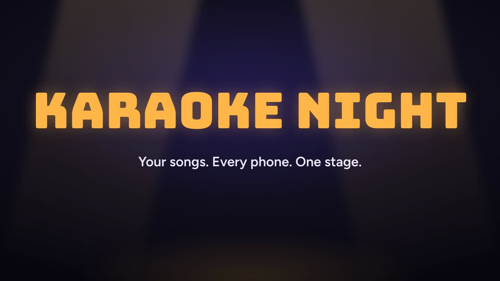
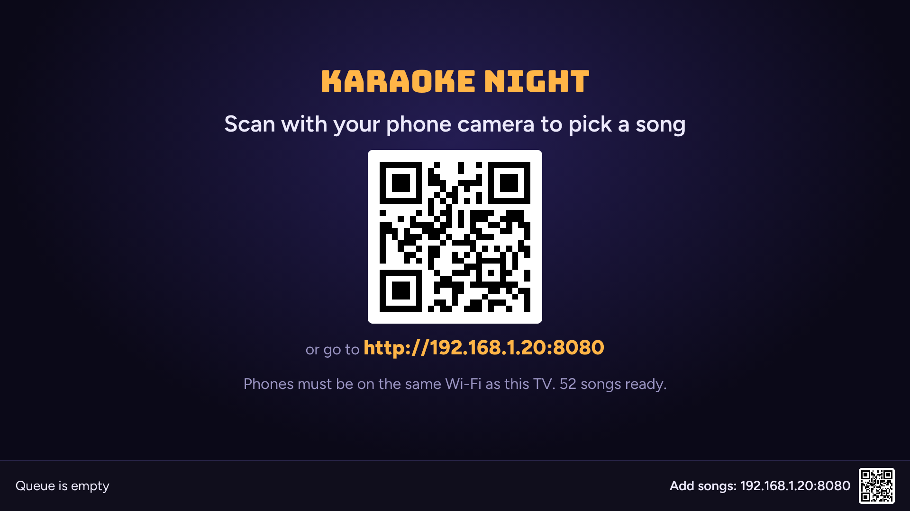
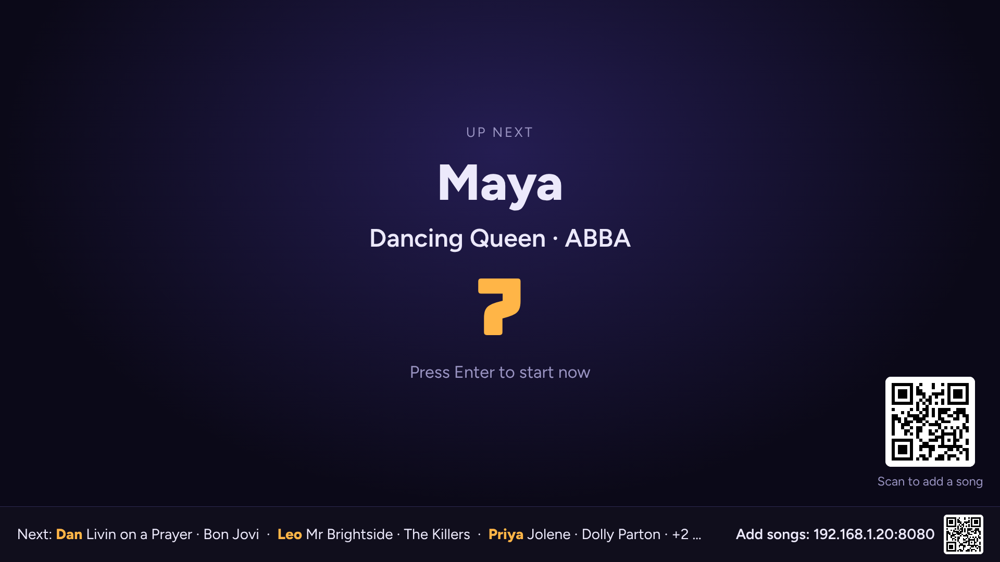
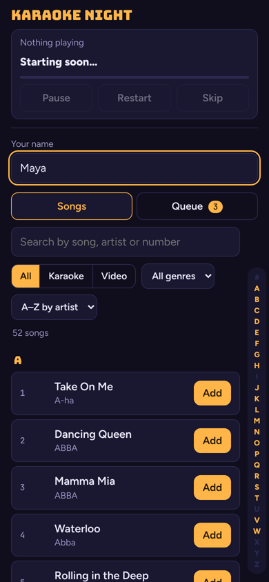
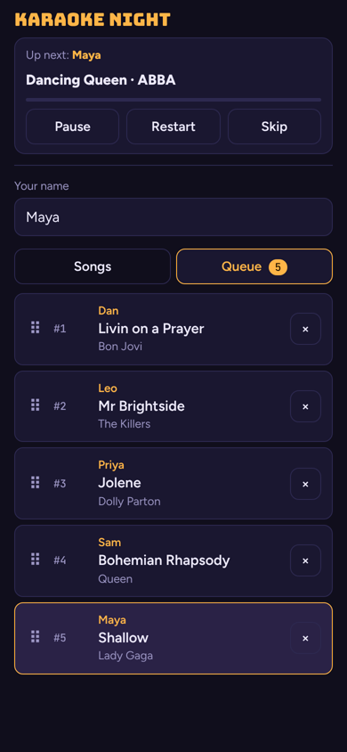

# Karaoke Night

A home karaoke machine that runs on your own computer. The TV plays songs from your USB drive or hard disk, and
guests pick songs from their phones. Everyone sees the queue, and each singer's phone buzzes when it's their turn.

[](docs/karaoke-night-promo.mp4)

▶ **[Watch the 30-second promo video](docs/karaoke-night-promo.mp4)**

| TV: waiting for songs | TV: up next | Phone: songs | Phone: queue | Phone: your turn |
| --- | --- | --- | --- | --- |
|  |  |  |  |  |

## Features

- **Plays your own files:** MP3+CDG pairs (also inside `.zip` files) and karaoke videos (`.mp4`, `.webm`, `.mkv`, `.mov`).
- **Guests use their phones:** they scan the QR code on the TV, type their name, search and tap **Add**. No app or account needed.
- **A shared queue:** every phone and the TV show who's singing what next. Drag songs to reorder them.
- **Your-turn alerts:** phones buzz, chime and flash "Your turn!".
- **Easy browsing:** search, an A–Z jump bar, Karaoke/Video filter, genres, sort by artist or song.
- **Smooth lyrics:** old blocky CDG text is upscaled so it looks clean on a big TV.
- **Fixes silent videos:** converts Dolby AC-3 sound that browsers can't play (needs ffmpeg, see below).
- **Works offline:** everything runs on your computer and your Wi-Fi.

## How to run

### 1. Install Node.js

Install [Node.js](https://nodejs.org) version 18 or newer (the free "LTS" download) on the computer connected to the TV.
Nothing else is required: the app has no other dependencies.

### 2. Get the code

Either click **Code → Download ZIP** on this page and unzip it, or clone it:

```
git clone https://github.com/NiviJah/Karaoke-night.git
```

### 3. Start it

- **Windows:** double-click `start-windows.bat`. If Windows asks about the firewall, allow access on **private networks** so phones can connect.
- **Mac / Linux:** run `./start-mac-linux.sh`, or `node server.js` in the project folder.

The window prints the addresses to use:

```
Karaoke Night is running.
  Songs folder: E:\Karaoke   <- set by the TV setup screen (config.json)
  TV screen:    http://localhost:8080/tv
  Phones:       http://192.168.1.20:8080   <- shown on the TV
```

### 4. Open the TV screen

On the computer connected to the TV, open **http://localhost:8080/tv** in Chrome, Edge or Safari and click **Start**.
Browsers only play sound after a click, so this one click is needed each time. The page goes full screen.

The first time, the TV asks you to **choose your songs folder**: click your USB drive or hard disk, open folders until
you reach your karaoke files, and click **Use this folder**. Every folder inside it is searched too. The choice is saved
in `config.json`, so next time it starts straight away. Press **S** on the TV computer to change it later.

### 5. Join from phones

Phones must be on the same Wi-Fi. Guests scan the QR code on the TV (or type the address shown), enter their name and
start adding songs.

## Your songs

Point it at a folder of songs, for example:

```
Karaoke/
  Queen - Bohemian Rhapsody.mp3
  Queen - Bohemian Rhapsody.cdg
  Rock/ABBA - Dancing Queen.mp3
  Rock/ABBA - Dancing Queen.cdg
  Adele - Hello.zip              (a zip holding the mp3 + cdg)
  Videos/Toto - Africa.mp4       (a karaoke video, lyrics in the picture)
```

- **MP3+CDG:** the `.mp3` and `.cdg` must have the same name. Audio without a matching `.cdg` is skipped.
- **Videos:** each video file is one song. Standard MP4s (H.264 video, AAC sound) play in every browser.
- **Names:** `Artist - Title` and `SC1234-05 - Artist - Title` are split into artist and title automatically.
- **Genres:** taken from each file's own genre tag when it has one, otherwise from its top folder (`Rock/...` is "Rock").
  Folder names like `Videos`, `MP3`, `Karaoke` or `Music` are ignored.
- **New songs:** restart the app to pick them up.

## Using it

### On the phone

- **Songs** tab: search by title, artist or song number and tap **Add**. Filter with **All / Karaoke / Video** and the
  genre menu, sort **A–Z by artist** or **by song**, and tap or slide along the **A–Z bar** on the right to jump.
- **Queue** tab: every upcoming song with the singer's name. Drag a song by its handle (⠿) to reorder it, or tap × to remove it.
- **Pause, Restart, Skip** control the TV (Skip asks you to tap twice).
- **Your-turn alerts** go to phones using the singer's name, while the page is open on screen.
  iPhones can't vibrate from a web page, so they get the chime and banner only.

### On the TV

Between songs the TV shows "Up next" with the singer's name and an 8-second countdown. The bottom bar shows the next
singers and a QR code for adding songs.

| Key | Does |
| --- | --- |
| Space | Pause / resume |
| Enter | Start the next song now (skips the countdown) |
| N | Skip to the next song |
| F | Full screen on / off |
| L | Lyrics look: smooth, soft, pixel |
| [ and ] | Move lyrics 50 ms earlier / later if they're out of sync |
| S | Choose a different songs folder |

## Troubleshooting

**Videos play without sound.** Some karaoke videos (often from DVDs) have Dolby AC-3 / E-AC-3 sound, which browsers
play silently. Install **ffmpeg** once and restart; Karaoke Night then converts just the sound (your original files are
never changed, copies go in the `converted` folder, which is safe to delete):

- Windows: `winget install Gyan.FFmpeg` in Command Prompt, then reopen the start file.
- Mac: `brew install ffmpeg`.

The window says `ffmpeg: found` when it's ready. Without ffmpeg, the TV tells you when a video's sound can't play.

**Phones can't open the address.** The computer may have extra virtual network adapters (VPN, WSL, Hyper-V, Docker).
The window lists every address; if the one on the TV doesn't work, add the right one to `config.json`:

```
{
  "songDir": "E:\\Karaoke",
  "address": "192.168.1.20"
}
```

**"Port 8080 is busy".** The app moves to the next free port (8081, 8082, ...) by itself; use the addresses it prints.
If it happens every time, an old Karaoke Night window is probably still running.

**Can't find the songs folder.** Check the drive is plugged in, then press **S** on the TV to choose it again.

## Other options (`config.json`)

| Setting | Meaning |
| --- | --- |
| `songDir` | The songs folder (set by the TV setup screen) |
| `address` | Force the address shown to phones |
| `ffmpeg` | Path to ffmpeg if it isn't found automatically |
| `youtube` | `true` turns on pasting YouTube links (off by default; see below) |

A folder given on the command line (`node server.js "E:\Karaoke" 8080`) or with `SONG_DIR` in the start file
overrides `songDir`.

**About YouTube:** the code can queue YouTube links, but it's off by default. In testing, YouTube blocked all 48
karaoke videos we tried, from every major karaoke channel, from playing outside youtube.com because of music licensing.

## Single-file player

[`standalone/karaoke-player.html`](standalone/karaoke-player.html) is a simple one-page MP3+CDG player with no server:
open it in a browser and drop in song files or `.zip`s. Handy for testing a song on any computer.

## Project layout

```
server.js            web server: song catalog, shared queue, live updates, media streaming
lib/zip.js           reads songs inside .zip files
lib/media-info.js    reads genre tags and video sound formats
lib/audio-fix.js     converts unplayable video sound with ffmpeg
public/tv.html       the TV screen (CDG player, videos, QR codes, setup)
public/remote.html   the phone page (songs, queue, controls, alerts)
public/cdg.js        CD+G decoder and lyric smoothing
standalone/          single-file browser player
promo/               source of the promo video (HyperFrames)
docs/                promo video and screenshots
```

## Promo video

The video in `docs/` is made with [HyperFrames](https://github.com/heygen-com/hyperframes): `promo/index.html` is the
whole video as an HTML page with timed animations. To change and re-render it (needs Node.js and ffmpeg):

```
cd promo
npx hyperframes@0.8.77 preview                  # live preview in the browser
npx hyperframes@0.8.77 render -q high -o karaoke-night-promo.mp4
```

## Credits

- QR codes: [qrcode-generator](https://github.com/kazuhikoarase/qrcode-generator) by Kazuhiko Arase (MIT), in `public/qrcode.js`.
- Fonts: [Bungee](https://fonts.google.com/specimen/Bungee) and [Figtree](https://fonts.google.com/specimen/Figtree) (SIL Open Font License).
- Promo animation: [GSAP](https://gsap.com), in `promo/assets/gsap.min.js`.
